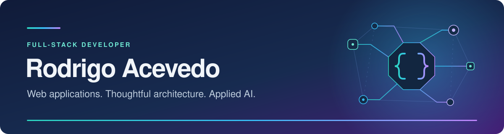

  

  
  
  

## 👋 Building beyond the interface

I'm Rodrigo, a **full-stack developer with a backend-first mindset**. I build web applications with a focus on clear APIs, maintainable architecture and the experience of the people using them.

My projects explore how AI can make information more useful: turning documents into learning paths, research into geographic context, and health topics into guided learning.

**Good software should be useful to people — and understandable to the developers who maintain it.**

## 🚀 Selected work

### 🌱 [Sagepoint](https://github.com/RodAcevedoF/sagepoint)
**Your documents, turned into a learning path.**

An AI-powered application that generates learning roadmaps from your own documents. A full-stack project connecting document-based learning with a structured way to navigate what comes next.

[Explore Sagepoint ↗](https://github.com/RodAcevedoF/sagepoint)

---

### 🌍 [Atlas](https://github.com/RodAcevedoF/atlas)
**Research with a sense of place.**

Turns a research question into a map of sourced claims. Readers can explore where events are happening, inspect the evidence for each place and read an accompanying intelligence summary.

[Explore Atlas ↗](https://github.com/RodAcevedoF/atlas)

---

### 🧠 [HealthBot](https://github.com/RodAcevedoF/healthbot-langgraph)
**Health education as a guided conversation.**

A patient-education prototype built with LangGraph. It searches medical sources, explains a chosen topic in plain language and reinforces learning through quizzes and feedback with citations. An exploration of educational workflows, not a clinical tool.

[Explore HealthBot ↗](https://github.com/RodAcevedoF/healthbot-langgraph)

## 🛠️ Technologies I work with

### Languages

  

### Frontend

  

### Backend

  

### Databases

  

### AI & agent workflows

### Delivery & tools

  

## 🤝 Let's build something useful

Open to collaboration, side projects and interesting problems — especially where web development, thoughtful backend design and applied AI meet.

**[Connect on LinkedIn](https://www.linkedin.com/in/rodrigoacevedodev/)** &nbsp; · &nbsp; **[Send me an email](mailto:raacevedof@gmail.com)**

---

Build things. Understand them. Make them better.

